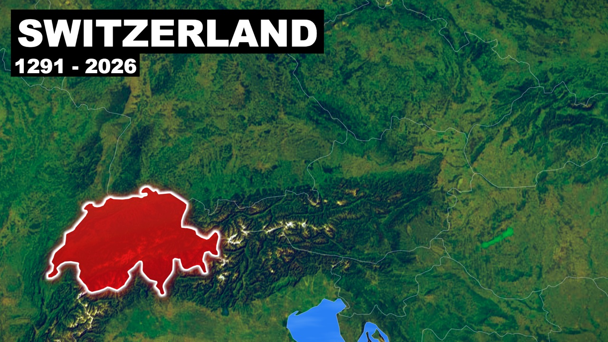
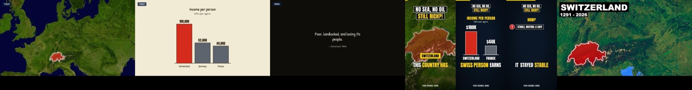

# 🗺️ Map History Video — a Claude skill

Make **animated map explainer videos** for YouTube, the "why is this country rich or poor?" kind, just by asking Claude:

> *"Make a video on why Argentina went from rich to poor"*

Claude checks that the topic already gets views, researches the facts, writes a clear chaptered script, downloads real public-domain photos, records a natural AI voice-over, renders a 1080p video with NASA satellite maps, and also makes a click-worthy thumbnail, subtitles, a YouTube description with chapters, and 3–4 vertical Shorts.

**Free and local:** no API keys, no credits. It uses the free Kokoro voice, the free Remotion renderer, public-domain NASA maps and free-licence Wikimedia Commons photos.




---

## What you get per video

| File | What it is |
|---|---|
| `out/<name>-final.mp4` | 1920×1080 video, 7–12 min, new visual every ~5 s, YouTube loudness (−14 LUFS) |
| `out/<name>-captions.srt` | English subtitles |
| `out/<name>-thumbnail.png` | Glowing-country satellite-map thumbnail |
| `out/<name>-youtube.txt` | Title, description with chapters and photo credits, tags |
| `out/vshort-<id>-final.mp4` | Vertical Shorts (1080×1920) with graphics and word-by-word captions |

---

## Installation

### Step 1 — Install the tools (one time)

You need three free programs on your computer:

| Tool | Why | How to install |
|---|---|---|
| **Node.js 18+** | renders the video | Download the LTS version from [nodejs.org](https://nodejs.org) |
| **ffmpeg** | audio and video processing | macOS: `brew install ffmpeg` · Windows: `winget install ffmpeg` · Ubuntu: `sudo apt install ffmpeg` |
| **uv** | installs the free AI voice (Python 3.12) | macOS/Linux: `curl -LsSf https://astral.sh/uv/install.sh \| sh` · Windows: `powershell -c "irm https://astral.sh/uv/install.ps1 \| iex"` |

(No Homebrew on a Mac? Install it from [brew.sh](https://brew.sh) first.)

Check that everything works by opening a terminal and running:
```bash
node --version && ffmpeg -version | head -1 && uv --version
```

### Step 2 — Add the skill to Claude

**Option A: Claude app (claude.ai or the desktop app)**
1. Download **[`map-history-video.skill`](https://github.com/pandeymynk/map-history-video-skill/releases/latest/download/map-history-video.skill)**.
2. Open it in Claude (drag it into a chat or open it from your downloads) and click **Save skill**. You can also go to **Settings → Capabilities → Skills → Upload skill**.

The skill needs to run commands on your computer (render video, run the voice), so use it where Claude has a terminal: **Claude Code** in the terminal or the desktop app's **Code** tab.

**Option B: Claude Code (terminal)**
```bash
git clone https://github.com/pandeymynk/map-history-video-skill.git
mkdir -p ~/.claude/skills
cp -R map-history-video-skill/map-history-video ~/.claude/skills/
```
Restart Claude Code. The skill is now available in every project.

### Step 3 — First run

Start Claude Code in an empty folder for your videos (e.g. `mkdir ~/map-videos && cd ~/map-videos && claude`) and say:

> *"Set up the map history video project and make the demo."*

Claude copies the project template, runs the one-time setup (about 5–10 minutes: it downloads the voice model, ~330 MB, and the NASA world map, ~20 MB), asks for your channel name and renders a 20-second demo. If you prefer to do it by hand:

```bash
cp -R ~/.claude/skills/map-history-video/template ~/map-videos
cd ~/map-videos
sh scripts/setup.sh
npx remotion render HistoryVideo out/demo.mp4
```

Then put your channel name in `src/brand.json`.

---

## Making videos

Just ask in plain words:

- *"Research topics with 400k+ views and make a new video on the best one"*
- *"Make a video: why Haiti is poor while the Dominican Republic is rich"*
- *"Make 4 Shorts for that video"*
- *"Make a thumbnail with Argentina glowing red and a date range"*
- *"Change the voice. Give me samples to choose from"*

A 10-minute video takes roughly 20–40 minutes to render on a modern laptop. Claude checks frames from every render before calling it done.

**Voices** (all free): `am_michael` (default, warm US male), `af_heart` (female, highest quality), `bm_george` (British male), and more. Ask Claude for samples.

---

## Folder layout

```
map-history-video/            ← the skill (what you install)
├── SKILL.md                  ← instructions Claude follows
├── references/               ← script format, Shorts, thumbnails, research, upload, troubleshooting
└── template/                 ← the video project Claude copies for you
    ├── src/                  ← Remotion components (maps, photo scenes, charts, Shorts, thumbnails)
    ├── scripts/              ← setup, voice, maps, Commons photo search/download, YouTube research
    ├── examples/             ← a complete worked episode (Haiti vs the Dominican Republic)
    └── episode/              ← your scripts (a demo is included)
```

---

## Troubleshooting

Common problems and fixes are in [`map-history-video/references/troubleshooting.md`](map-history-video/references/troubleshooting.md). Quick ones:

- **`kokoro` won't install** → install `uv` (Step 1) and run `sh scripts/setup.sh` again. The voice needs Python 3.10–3.12, and uv handles that for you.
- **A map shows the whole world** → a country in the map has far-away islands (France, Netherlands, USA, Chile…). Leave it out of the map's `focus` list.
- **Render seems stuck** (no progress, CPU idle) → stop it and run it again.

Tested on macOS (Apple Silicon). It should also work on Linux and Windows (use WSL or Git Bash for the `.sh` scripts). The photo cut-out helper (`cutout.swift`) is macOS-only; elsewhere use any background-removal tool for thumbnail faces.

---

## Licences and credits

- Code in this repository: MIT licence (see `LICENSE`).
- Voice: [Kokoro-82M](https://huggingface.co/hexgrad/Kokoro-82M) (Apache-2.0), fine for monetised videos.
- Maps: NASA Blue Marble (public domain) and Natural Earth borders via `world-atlas` (public domain).
- Fonts: Anton, Patrick Hand, Comic Relief (SIL Open Font Licence).
- Photos: you download them from Wikimedia Commons. Use only Public domain / CC0 / CC BY / CC BY-SA files, and credit them in your description. The skill collects the credits for you.
- Music: none is included. Add royalty-free tracks you have the rights to in `template/assets/music/`.

You are responsible for the accuracy of what you publish. Claude rounds figures and marks estimates, but double-check important numbers.
